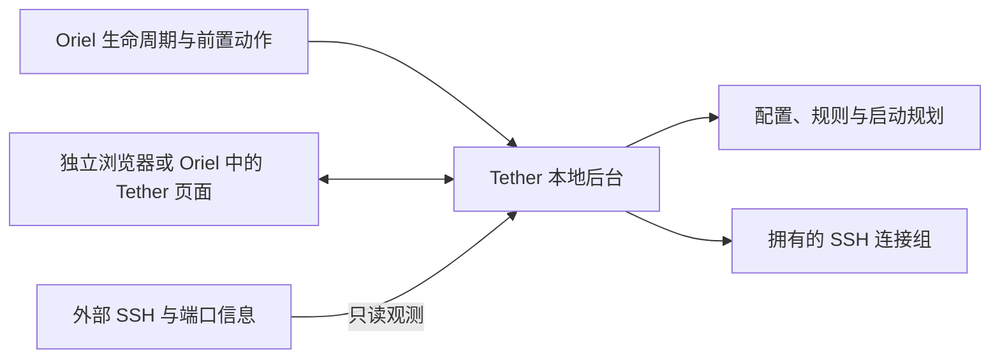

# Tether 当前设计基线

- 日期：2026-10-22。
- 状态：独立转发闭环和 Oriel 最小接入已实现；需求的完整程度与验证边界见[实现契约](../implementation.md)及[实际记录](../../verification.md)。
- 产品：Tether，本地 SSH 与端口转发管理工具。
- 首版平台：Windows，原生 OpenSSH。
- 决策背景见[决策记录](decisions.md)，实施入口见[实现交接](../implementation-handoff.md)。

## 1. 定位与核心原则

Tether 以普通 SSH 端口转发为首个完整闭环，再完善主机、SSH 配置和密钥管理。独立运行与 Oriel 集成使用同一套本地能力和界面，工具业务数据继续归 Tether 与原有 SSH 文件负责。

最重要的运行原则：**开启新转发时不打断已有连接。** 对已经运行的转发，保留原连接；本次缺少的转发另起 SSH，同批参数兼容时尽量放进一个 SSH 进程。关闭允许按连接组、主机或全部处理，不为了逐端口独立关闭增加首版复杂度。

软件只管理自己创建的运行资源。端口、命令、主机或规则内容相同，不自动授予管理权；外部进程接管不属于首版能力。

## 2. 已确认需求

| 编号 | 要求 |
| --- | --- |
| R01 | Windows 首版，调用本机 OpenSSH；独立工具、独立 Git 仓库，离开 Oriel 仍可运行 |
| R02 | 以主机为中心登记和批量编辑端口映射，支持临时转发、名称与备注 |
| R03 | 普通 SSH 转发方向按本地、远程和动态转发组织；先打通普通转发，再完善 SSH 管理 |
| R04 | 常用 SSH 参数有表单，并提供可搜索的版本化完整参数目录；支持跳板链、多个身份文件、配置文件选择和 `-o` 临时覆盖 |
| R05 | 区分隐藏本地窗口、不启动远端 Shell 与 SSH 日志静默；展示实际执行参数及生效配置 |
| R06 | 访问原有 SSH config，支持打开文件编辑；保留注释、Include、Match 与原有语义 |
| R07 | 转发带保活、断线重连、状态与日志；手动停止同时取消重连 |
| R08 | 可视化启动与停止，按实际 SSH 连接组呈现操作范围；临时转发可停止或保存为规则 |
| R09 | 只检测已登记或临时托管映射对应的终端 SSH，匹配时标记已启动；不展示无关外部连接，不接管进程 |
| R10 | 响应时间只显示一个值；首次连接时测试，主动测试后更新，不另设连接耗时指标 |
| R11 | 自定义批量启动计划，保存明确选中的规则引用，一键启动；主机后续新增规则不自动纳入，重复执行不重复创建连接 |
| R12 | 计划执行只补缺失转发，已有连接不重启；新批次不会为了合并而重建旧连接 |
| R13 | 密钥管理可视化：列出已有密钥和 Agent 身份，提供生成、查看、公钥复制、登记及加载等工具操作 |
| R14 | 本地状态和本地文件为基础，Oriel 不复制维护 Tether 的 SSH 配置和密钥 |
| R15 | UI 与 Oriel 风格一致，支持浅深主题、紧凑信息布局和按需展开详情 |
| R16 | 提供 Oriel 生命周期入口与公共动作；Oriel 调度工具，工具管理内部 SSH 连接 |
| R17 | 前置转发显式引用稳定规则 ID，复用已有转发，确认就绪后打开依赖页面 |
| R18 | Oriel 完全退出时停止接入实例的 Tether 托管转发并取消重连；外部连接保持不动 |
| R19 | 前置转发默认保留到本次 Oriel 会话结束；切换、隐藏或关闭页面不自动停止连接 |
| R20 | 提供随包说明文档，独立页面与 Oriel 内均可点击阅读；已实现 |

这些编号用于需求与验收对应，不代表最终配置字段或公共协议名称。

## 3. 概念模型

| 概念 | 作用 | 关键边界 |
| --- | --- | --- |
| 主机配置 | SSH 目标／别名、来源文件、连接覆盖与备注 | 相同 IP 的不同别名不自动视为同一身份 |
| 转发规则 | 方向、监听端、目标端、主机引用、名称和备注 | 稳定 ID 与显示名称、端口、排序分开 |
| 启动计划 | 一批规则的引用及启动选项 | 是启动清单，不拥有连接；修改或删除计划不停止连接 |
| 运行连接 | 一条实际 SSH 进程及其转发集合 | 停止、重连和清理的主要单位 |
| 临时转发 | 由 Tether 启动但尚未保存的规则 | 属于托管资源，允许停止或登记 |
| 观测记录 | 已知映射对应的终端 SSH 与可确认监听 | 规则匹配与托管权限相互独立，不保存无关连接清单 |
| 使用方 | 手动操作、计划、Oriel 页面或插件 | 记录关联，便于解释连接用途；首版不驱动逐页面回收 |

登记信息和实际运行状态分别保存。删除登记不应隐式杀死正在使用的连接；仍运行的项可以继续作为临时托管项展示。

主机是界面的组织中心，连接配置和端口映射在主机内编辑；主机与转发页合并，不再提供主机分类字段。内部稳定 ID 保留，主列表隐藏，在详情提供复制。旧配置的 category 字段为兼容读取保留，不参与运行。

计划固定保存选中的规则 ID 集合。即使通过主机全选，后续新增规则也必须由用户主动选入计划；固定的是成员范围，执行仍读取所引用规则的当前配置，不冻结规则参数。

## 4. 启动、批量与停止

启动时读取配置并形成快照，区分已运行、正在启动、待启动、配置变化和冲突。缺失规则按连接参数兼容性分组，分别启动新 SSH。

```text
已运行：连接 1 承载 A、B
请求：A、B、C、D、E
结果：连接 1 保持；C、D 参数兼容则新建连接 2；E 按自身参数新建连接 3
再次请求同一清单：复用全部已有结果，不创建重复连接
```

端口被外部占用不等于规则已经启动；相同监听端指向不同目标应报告冲突。并发请求相同规则时合并启动等待，不因双击或不同计划产生重复进程。

连接组新建失败只影响新组，不停止旧连接，不回滚其他已经成功的组。运行参数变更显示待应用，用户主动重新启动时才应用；自动重连沿用该连接的参数快照。

成功停止并清理的运行记录自动移除，不保留连接历史。失败信息保留至用户关闭或重试，不允许通过关闭失败提示停止活动连接。

停止提供连接组、主机和全部托管连接三个层次。按组停止会中断组内所有转发，界面必须清楚展示影响范围。先取消重连，再清理对应进程及所拥有的子进程，不按进程名称或监听端口批量杀进程。

详见[SSH 运行设计](ssh-runtime.md)。

## 5. 参数、配置与数据归属

SSH 目标／别名是常规入口，不另设重复的用户字段；User 仍可作为高级覆盖，与目标内用户冲突时校验失败。采用常用表单、可搜索参数目录、高级有序选项和可读生效结果预览；表单与原文共用一份有序覆盖数据，允许恢复继承。目录基于 OpenSSH portable 10.0 的 102 项配置指令，不表示本机 Windows 客户端全部支持；以显式原生解析和启动结果为准。普通协议与认证参数尽量沿用 OpenSSH；影响进程托管的选项由运行模式处理，不能让 `-f` 等选项使进程脱离管理。

SSH 主机配置、身份文件和 known_hosts 使用原有本地文件。Tether 的配置保存规则、计划、备注、引用、覆盖与偏好，不复制整份用户配置形成第二个编辑来源。

原始文件编辑需考虑外部同时修改、路径引用、备份和写入失败。来自 SSH config 的转发要标明来源，避免自动复制出另一份可编辑规则。新批次必须避免重复继承已运行的配置内转发。

密钥、Agent 和主机指纹分别管理；首次主机确认、密码、私钥短语和多因素认证均需要可用交互。密钥文件删除、Agent 卸载和远端撤销授权是不同操作。

详见[配置与密钥](config-and-keys.md)。

## 6. 监测与响应时间

托管连接使用自身启动记录、进程和网络信息核对状态。终端 SSH 检测仅服务于已登记或仍在托管列表内的临时映射：匹配 SSH 目标、用户／端口覆盖、配置路径、方向、完整监听与目标端点，并核对同一进程的已建立连接；本地／动态转发还须有其所属监听。匹配项在原映射行显示“运行中 · 终端连接”，不新增外部连接总览。

只读关联不会获得停止、重连或退出清理权限。未知参数、配置内隐式转发、无法确认的上下文、跳板或权限不足时不猜测匹配；检测轮询不运行 `ssh -G`，避免反复触发 `Match exec`。远程转发可确认 SSH 已连接及显式参数，但不把本机信息当作远端监听就绪。

一个界面位置只展示一个响应时间，成功值使用清晰的状态色，测试中及无法测量显示文字状态。建议放在主机标题旁，默认测 SSH 地址的 TCP 响应；首次测试与主动测试使用同一口径。通过跳板才可达的目标无法可靠测量时显示无数据，不把跳板或本机监听响应冒充目标响应。

响应时间不等于完整服务可用性。必要的进程状态、转发建立状态和错误原因可以在状态或详情中呈现，不扩展成额外延迟卡片。

## 7. Oriel 生命周期与前置资源

Oriel 管理插件的启动、就绪检查、状态和退出请求，Tether 管理内部 SSH、保活与重连。后台可以不打开自己的页面，照样接受已登记规则的启动动作。

前置动作明确引用 Tether 插件和稳定规则 ID。已有或正在启动的规则复用，未运行的规则才增量创建；转发就绪后开放依赖页面。失败只影响本次依赖，不清理其他使用方的既有连接。

同一转发被多个页面使用时记录多个使用方，保持到本次 Oriel 会话结束。页面切换、关闭、打开失败不触发自动回收。用户主动停止后，旧的前置请求不得不断强制拉起；下一次显式启动或重试才重新请求。

退出 Oriel 时先停止依赖方，再请求 Tether 停止全部托管转发并取消重连；终端及其他程序建立且未托管的连接保持不动。匹配到登记不改变归属。

`oriel.ps1` 是 Windows 生命周期入口方案；宿主检查声明的托管动作是否具备有效入口，缺失时诊断并标记无法托管。纯网页或仅连接已有服务不因此被强制要求同名启动脚本。

详见[Oriel 接入设计](oriel-integration.md)。

## 8. 架构与交付方向

采用 Vue 3／TypeScript 界面、Rust 本地后台和系统 OpenSSH。独立运行可通过本地后台提供同一套页面，在浏览器打开；Oriel 展示同一个页面，不要求额外开发第二套业务 UI。

`tether.exe serve` 当前提供本地页面地址，尚无独立桌面窗口。用户明确独立桌面应用并非必要，当前重点为 Oriel 内的工具应用布局，不为移除地址栏增加桌面外壳。保留现有独立浏览器使用方式，以及 Vue、Rust 后台、系统 OpenSSH 的分工。

2026-10-22 已实现应用内说明与通用工具应用布局接入。声明以 `presentation: "application"` 选择无浏览器地址栏及通用浏览导航的布局，以 `documentation: "USER_GUIDE.md"` 提供同一份随包说明；独立 UI 将该源文件编入资源。宿主已支持默认及额外读取目录自动发现，Tether 不负责扫描或注册自己。展示不改变后台生命周期，也不按 Tether ID 或 URL 写死，具体见[界面设计](ui.md)与[实现契约](../implementation.md)。



UI、业务配置、启动规划、进程管理、观测、认证和 Oriel 适配分层。页面不直接执行任意 shell；本地服务的控制接口不能因绑定 localhost 就默认为任意网页可调用。

不先建立 Windows Service、独立 SSH 协议实现、通用 SDK 或流程编排引擎。必要时升级 Oriel 增加宿主能力；能力存在后，兼容插件通过声明接入，无需为每个插件重新编译宿主。

## 9. 首版之外与工程约束

以下不作为首版前置条件：Linux／macOS／WSL 执行环境、云同步、多人共享、完整终端与 SFTP、服务器监控、通用脚本面板、定时调度、逐端口动态取消、内部 SOCKS 中继和任意外部进程接管。

计划首先是保存的启动集合，定时触发若未来需要再单独设计。密钥管理不自动扩展为远端 authorized_keys 管理。

以下工程事项已在初版中部分收敛，准确结果见[实现契约](../implementation.md)和[验证记录](../../verification.md)；其余仍可按实现推进，不需要重新确认产品方向：

- 配置文件名、版本、ID 格式、字段、迁移和目录布局。
- CLI 参数拼写、公共动作的准确输入输出、错误码与取消语义。
- 命名管道或本地网络控制通道、就绪通知与实例发现方式。
- Rust 和前端依赖、版本声明、锁文件、打包及发布组织。
- 原始 SSH 配置解析与运行快照的兼容实现。
- Windows 进程归属、异常退出清理、认证交互和可辨识观测方式。
- 保活与重连的默认值、日志容量及探测超时。

如实现取舍会改变启动保护、管理权限、退出策略或配置权威，必须先明确该行为变化；其余细节应依据代码与验证收敛。
