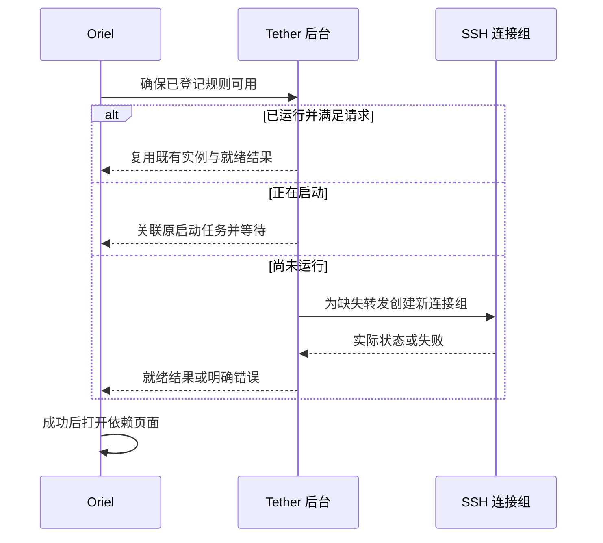

# Oriel 接入与前置资源

状态：本文保留已确认的产品要求；已实现部分、准确字段和当前限制见[实现契约](../implementation.md)及[实际验证](../../verification.md)，下文候选方案不等于全部已交付。

## 1. 当前宿主能力与新增工作

初始交接时，Oriel 已有最小 `plugin.json` 网页声明、外部目录登记、本地配置和原生网页视图。它能展示已经运行的工具页面，但未实现通用插件启动、停止、脚本执行、进程托管或前置依赖调度。

当前已分别交付独立闭环和宿主最小接入；准确接口与实际验收见[实现契约](../implementation.md)及[验证记录](../../verification.md)。下文保留最初设计分层和候选示意，不作为已实现 CLI。

新增宿主能力可以要求升级 Oriel。能力形成后，兼容插件应通过声明接入，不为每个插件写死 ID、页面路由或源码目录并重新构建宿主。

## 2. 职责

| 职责 | Oriel | Tether |
| --- | --- | --- |
| 插件登记、自动启动和生命周期调度 | 负责 | 声明能力并提供入口 |
| SSH 主机、规则、计划、密钥和备注 | 引用，不重复编辑 | 负责业务与本地数据 |
| 页面打开前需要哪些资源 | 保存依赖关系并调度 | 按规则或计划执行 |
| SSH 进程、保活、重连和停止 | 通过公开动作请求 | 唯一实际执行者 |
| 前置动作等待、超时、取消与结果呈现 | 负责通用流程 | 提供真实状态与错误 |
| Oriel 完全退出的清理 | 发起退出与停止请求 | 取消重连并清理托管转发 |
| 外部 SSH 进程 | 保留外部边界 | 只做明确观测 |

Tether 页面只调用自己的本地后台。外部网页不继承 Oriel 的宿主命令、文件或凭证权限；由用户在本地配置的前置动作由宿主调度，网站不能自行提出任意 shell 请求。

## 3. 生命周期入口

Windows 使用 `oriel.ps1` 作为生命周期入口方案。脚本包装实际程序与公共操作，不能成为另一套独立业务管理器。

候选动作如下，准确拼写、字段和退出码在实现时确定：

| 动作 | 预期行为 |
| --- | --- |
| check | 检查程序、SSH 客户端和必要绑定，报告缺少项，不自行安装 |
| start | 启动后台或连接已有实例，返回真实实例身份和页面信息 |
| status | 查询指定实例是否存活、是否就绪及必要诊断 |
| stop | 请求指定实例按约定停止，清理其托管资源 |

宿主验证声明的动作及入口是否存在、是否兼容。需要托管却缺入口时报警并标记无法托管；不能靠扫描某个同名文件就默认获得所有能力，也不要求纯网页或已有远程服务虚构启动脚本。

start 成功与后台就绪分开。可采用前台受跟踪进程加就绪通知，或明确的实例发现方式；不只依据包装脚本退出码或任意 PID 判断。脚本从自身目录定位程序，工作目录由声明明确，不依赖开发机父目录布局。

提供脚本不等于现在执行脚本。获取、安装、更新、启动和停止分别表达，不通过启动入口自动安装依赖、修改全局执行策略或运行未知更新操作。

## 4. 后台、页面和实例

Tether 后台不打开自己的页面，也能执行前置转发。独立启动时可以打开系统浏览器，Oriel 启动时可以只取得页面地址并嵌入。

建议同一用户、同一业务配置使用一个后台实例，避免独立打开与 Oriel 接入分别争用端口。实例身份、控制通道和存活检查必须明确；只读发现记录不是进程所有权证据。

Oriel 保存插件位置、启动偏好、实例关联和依赖引用。Tether 保存实际业务配置。页面地址和控制地址可以运行时返回，准确形式待实现；不能将开发目录或开发服务器当成发布接口。

本地服务控制接口需验证调用身份与来源，不能让任意网页因服务监听 localhost 就控制 SSH 或密钥。绑定、凭证传递与页面装载方式在实现时验证。

## 5. 前置动作与稳定规则引用

原始命令是通用动作的一种表达；SSH 转发更适合通过资源动作提供。一次性命令等待结束，持续资源需要实例、就绪状态和清理策略。

以浏览器打开管理页为例：

```text
入口：运维后台
前置资源：Tether 的已登记规则 ops-web
资源就绪后：打开 http://127.0.0.1:18080
保留策略：本次 Oriel 会话
```

推荐的逻辑动作是“确保规则可用”，不是盲目执行一条新的 `ssh -L`。调用者提供规则 ID 和使用方，Tether 自己读取主机、密钥、跳板和参数。

以下保留为设计阶段的命令示意，未采用该拼写；实际 CLI 和 stdio 见[实现契约](../implementation.md)：

```text
tether.exe forward ensure --rule ops-web --consumer browser:ops
```

规则被重命名、重新排序或修改备注后，引用保持有效。规则不存在、参数不一致或监听冲突时返回明确错误，不能按端口猜测别的规则替代。

## 6. 请求、复用与结果



结果需要表达：请求身份、规则身份、后台与运行连接身份、复用还是新建、状态、实际监听端、错误与是否可重试。具体字段名、输出载体与版本号未冻结。

Tether 手动启动、计划和 Oriel 前置动作共用启动规划与运行登记，避免三套端口判断。多个调用方同时请求同一规则时共享结果，新规则按兼容性形成新批次。

就绪是该次请求实际资源的结果，不是“某个端口能连接”。配置已变化、原运行不满足当前请求时返回待应用或冲突，不重启旧连接。前置失败不回滚其他已经运行的连接。

## 7. 使用方与会话生存期

记录规则、连接组和使用方，例如规则 ops-web 由连接 12 承载，使用方包括手动操作、某启动计划和两个页面。记录用于可见性和定位，不在首版实现逐页面释放。

默认保留至本次 Oriel 会话结束：

- 切换、隐藏或关闭页面不停止转发。
- 页面打开失败，已经建立的前置转发继续保留，便于重试。
- 页面重绘、普通切换和状态轮询不重复启动或强制刷新网页。
- 用户手动停止后，旧等待或轮询不持续强制重新启动。
- 下一次明确启动或重试才重新请求资源。

资源中断后可保留页面实例并显示状态，由 Tether 在仍允许运行的情况下重连。用户取消产生的停止与网络异常区分，不能由 Oriel 和 Tether 两套重连器互相拉起。

## 8. 退出与管理边界

Oriel 完全退出时先结束依赖方的使用流程，再请求 Tether 取消重连并停止当前接入实例的全部托管转发。规则和计划配置保留，实际运行连接停止。

Tether 托管转发包括在该实例内由手动、临时、计划或前置动作启动的连接。外部是指未交给 Tether 托管、由终端或其他程序创建的连接，不以是否显示在同一规则下判断。

连接已有 Tether 实例时，也要清楚记录接入实例和退出清理范围，不把“连接已有后台”误认为“所有机器上的 SSH 都归当前 Oriel”。准确的实例退出与后台保留方式在实现中收敛，但不能改变托管转发停止、外部不动的已确认行为。

进程异常或脚本停止超时的清理，只能基于明确拥有的进程与实例。不得全局结束 ssh.exe、按端口杀未知进程，或停止其他应用共享的外部 Agent。

## 9. 原生命令的关联与归属

| 创建方式 | 与登记的关联 | 生命周期归属 |
| --- | --- | --- |
| 通过 Tether 按规则 ID 请求 | 直接、确定 | Tether 执行，Oriel 调度 |
| Oriel 直接创建并跟踪原生 SSH | 有足够参数或显式元数据时可关联 | Oriel 自己管理；Tether 只观测 |
| 用户终端或其他程序创建 | 只在明确匹配时标注 | 外部，退出时保持不动 |

转发可来自配置文件，解析一条原生命令不一定能完整识别。因此推荐前置脚本调用 Tether 公共动作，而不重复实现 SSH 启动和回收。

外部进程即便恰好满足目标监听，也不默认成为可清理的前置资源。首版将不明占用报告为冲突；未来若增加只检查外部服务的依赖类型，其只读与退出不清理语义需要单独声明。

## 10. 宿主范围与验收目标

- 版本化能力声明、动作发现与入口诊断。
- 插件后台启动、实例关联、真实就绪与失败状态。
- 前置资源的稳定引用、调用、等待、超时、取消和结果展示。
- 需要时先启动资源提供方，再执行使用方动作；检测无效或循环依赖。
- 会话结束时按依赖关系清理，保持业务资源只有一个实际管理者。
- 插件自身后台就绪与某条转发就绪分别判断。
- 保持现有网页权限隔离，不让外部页面获得宿主 shell 或文件权限。

先为 Tether 形成最小完整闭环，不预先创建通用 SDK、流程编排引擎或独立协议仓库。正式修改宿主时需同步 Oriel 的设计与实际实现状态。
