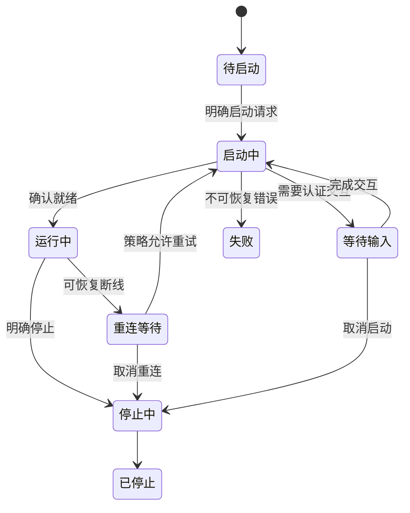

# SSH 运行、计划与观测

状态：本文保留已确认的产品要求；已实现部分、准确字段和当前限制见[实现契约](../implementation.md)及[实际验证](../../verification.md)，下文候选方案不等于全部已交付。行为边界以[当前基线](current-design.md)为准，配置解析见[配置与密钥](config-and-keys.md)。

## 1. 规则与连接的关系

规则是可保存的意图，连接是当前实际运行的一条 SSH 及其承载的转发。一次启动可以产生多个连接组，一个连接组可以承载多条规则。

原生执行形式可包含多个 `-L`、`-R` 或 `-D`。分组只覆盖本次新建项，不把新项追加到旧进程，也不为减少进程数而重启或合并既有连接。

概念字段如下，名称不代表最终 schema：

| 对象 | 需要表达的信息 |
| --- | --- |
| 规则 | 稳定 ID、主机引用、方向、监听地址与端口、目标地址与端口、名称、备注、来源 |
| 计划 | 稳定 ID、名称、备注、规则 ID 集合和显式自动启动设置 |
| 连接组 | 运行 ID、后台实例身份、拥有的进程句柄、启动时间、参数快照、规则集合、使用方、状态 |
| 一次启动请求 | 请求 ID、触发方、选中规则、已复用、新建、冲突、失败和取消结果 |

规则的显示顺序、备注或名称改变，不应导致运行语义变化。规则删除后原连接可继续作为临时托管项存在，直至明确停止。

## 2. 增量启动算法

1. 解析本次请求的规则和 SSH 连接配置，形成可校验的运行意图。
2. 对启动操作使用一致的互斥或合并机制，避免两个请求同时创建相同转发。
3. 对已运行且参数满足请求的项返回复用结果；正在启动的项加入原操作等待。
4. 相同规则已运行但配置发生变化时，返回待应用状态，不替换原连接。
5. 预检查明确冲突和参数错误，将不可启动项单独报告，继续规划其他有效项。
6. 对缺失项按兼容连接上下文分组，每组创建新 SSH。
7. 分别等待各组就绪，记录成功或失败；不回滚其他组或既有连接。

预检查不能消除启动瞬间的端口竞争，最终结果以实际 SSH 与进程、监听反馈为准。检查成功不是占用权证明。

请求 A、B、C，而 A 已运行时，B、C 才属于新建集合。两个计划同时需要 B 时，共享一个启动结果。取消一个等待方不能误杀另一个使用方已在使用的连接。

## 3. 分组兼容条件

至少考虑以下实际生效的内容：

- SSH 可执行文件与 Windows 运行上下文。
- 目标地址、端口、用户、主机别名语义与代理／跳板链。
- 身份文件、Agent、认证顺序、主机验证和相关配置。
- `-o` 覆盖、协议设置、保活和重连策略。
- 管理模式、必要日志行为及转发建立策略。

只按 IP 或主机显示名称分组不够。不同规则允许合并的前提是各自要求能同时满足；不得静默选择其中一个冲突参数。

具体兼容指纹应排除备注、界面排序和计划显示名称。参数快照只记录必要配置和文件引用，不复制私钥、密码或口令。

## 4. 启动失败与就绪

建议每个新组采用完整建立策略：任何请求的转发建立失败，该新组报告失败；`ExitOnForwardFailure=yes` 可作为原生执行依据。其能力不等于目标业务服务健康。

就绪反馈要区分实际可确认的层次：进程创建、认证进行中、等待输入、SSH 建立、转发建立、失败。不能仅凭进程未退出或本地某端口能连接就认定本组成功。

本地转发、反向转发和动态转发的确认方式不同，实施时必须使用本机客户端能力验证。无法准确确认的结果应保留未知或超时，不伪造 ready。

首次认证、私钥短语、主机指纹确认和多因素认证允许进入等待输入状态，应有超时、取消与返回错误的路径，不得在隐藏控制台中永久挂起。

## 5. 保活与重连

SSH 协议保活交给 OpenSSH，连接组退出后的重启由 Tether 负责。目标服务探测不自动等价于重启 SSH。

建议对临时网络错误使用退避、上限与少量抖动；稳定运行后重置退避。认证失败、主机指纹变化、配置无效或端口冲突应暂停并显示原因，避免无限快速重试。

自动重连沿用连接组的启动参数快照，用户显式重启才读取新设置。快照不冻结文件内容：密钥、known_hosts 等外部文件改变仍可能导致重新认证失败，应按实际结果处理。

手动停止、全部停止和 Oriel 退出均必须先清除继续运行意图并取消退避中的任务，防止刚结束进程又被重连器拉起。失效的旧异步回调不得覆盖新连接状态。

## 6. 停止与 Windows 进程归属

停止边界为连接组、主机下的托管连接或全部托管连接。关闭组会结束组内现有通道和监听；不承诺逐规则独立关闭。

Windows Job Object 是管理本组 SSH 与其拥有的跳板／辅助子进程的候选方案。需要验证句柄生存期、子进程归属、取消、异常退出与残留处理。不得把外部 Agent 或用户独立服务加入该组并随之清理。

进程归属来自创建记录、实际句柄和实例身份，不只来自 PID、进程名或端口。PID 重用、后台重启或来源不明时，宁可报告无法确认，也不接管或结束未知进程。

清理完成后移除成功停止的运行连接，不保留历史。失败连接保留内存中的诊断，只有已结束、无进程且无重连意图时允许关闭；重试同一映射清理旧失败提示，不影响活动连接。

Tether 的“全部停止”只处理自己的托管连接。Oriel 直接跟踪的原生前置进程若存在，由 Oriel 自己管理，Tether 只观测；推荐统一走 Tether 的公共规则动作。

## 7. 计划与自动启动

计划是规则引用清单。执行时读取当前规则并建立本次运行快照；修改或删除计划不停止任何连接。

成员清单固定保存用户选中的规则 ID，不采用“该主机当前及未来全部规则”的动态选择。主机后续新增规则不自动纳入已有计划，需用户编辑计划主动添加；已选规则的参数仍按执行时的当前配置读取。

重复执行返回已运行／已复用、新建、配置待应用、冲突或失败的结果摘要。某规则来自多个计划时，不产生多份端口绑定。

“Oriel 启动 Tether”与“Tether 启动哪些计划”分开配置。默认不能把全部已登记规则当成自动启动项，自动启动需要显式选择计划。手动全部停止后，已保存计划不会作为持续调和器立即重建连接。

定时、复杂工作流、跨计划资源释放和逐页面引用计数回收不是首版必需能力。

## 8. 外部观测与匹配

检测范围仅为已登记及仍在托管列表中的临时映射，不再列出无关外部 SSH 或原始命令行。Windows 定期只读查询 SSH 进程及其所属 TCP 连接；只解析命令行显式的 `-L`、`-R`、`-D` 或对应 `-o` 转发参数。核对 SSH 目标、显式用户与端口、配置文件路径、方向、完整监听端和目标端；同端口不同目标不匹配。检测轮询不执行 `ssh -G`，不触发原配置的 `Match exec`。

本地／动态转发须同时有同一 SSH 进程的已建立连接和监听；匹配后在原映射上标为已启动，并可在显式启动时返回只读复用结果。远程转发只能确认 SSH 连接与显式声明，不能验证远端监听；显示来源限制，不满足前置就绪，不重复启动或接管。

配置内隐式转发、上下文不足、跳板／代理、控制复用与权限不足时保持未确认；不把当前配置推断为旧进程参数。配置修改、登记删除、进程退出或监听消失后关联失效。匹配与托管归属完全分离，停止、自动重连和 Oriel 退出只处理自己创建的组。

## 9. 单一响应时间

只保留一个响应时间值，首次可测时执行一次，主动测试后覆盖旧值；更新时间和方法放在详情或提示中。

起步方案为目标 SSH 地址的 TCP 响应时间，显示在主机标题旁，不在每条规则重复展示。通过跳板无法直接探测的主机可显示无数据，不取本机监听、跳板或其他地址的值冒充目标值。

不得将对本地转发端口的 connect 耗时直接当成远端业务响应。未来如增加协议探测，应仍保持统一清楚的展示口径，不恢复多个延迟指标面板。

## 10. 状态模型建议

连接组可使用待启动、启动中、等待输入、运行中、重连等待、失败、停止中、已停止等状态；准确枚举在实现时冻结。

状态转移必须能关联具体运行代次，避免旧失败事件改变已重启组的状态。
